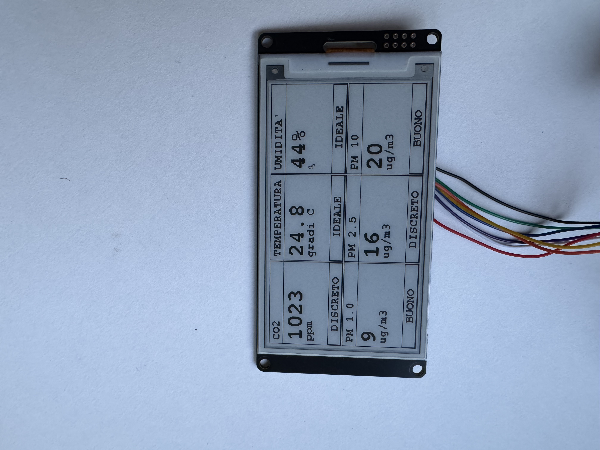
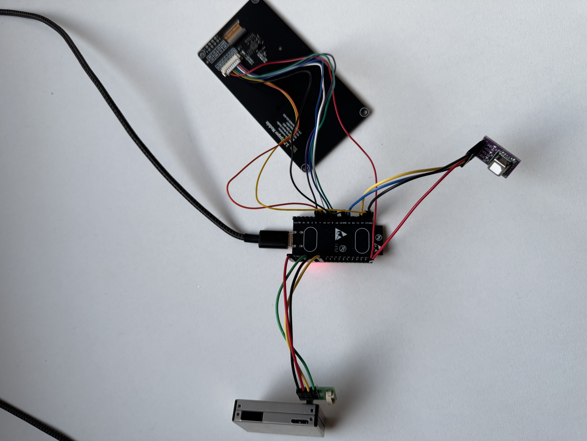
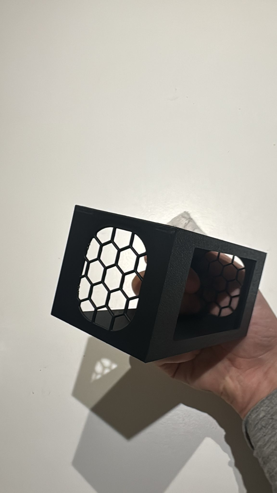

# 🌬️ ESP32 Air Quality Monitor

An indoor air quality monitor built with ESP32, displaying real-time readings on a 3.7" e-paper display. Measures CO2, temperature, humidity, and particulate matter (PM1.0, PM2.5, PM10).

Sensors run continuously for stable readings. The display updates every 2 minutes.

[](https://youtu.be/02VMEx7p5A8)

> 📹 Click the image above to watch the project video

---

## 🛒 Bill of Materials

| Component | Description | Approx. Cost |
|-----------|-------------|--------------|
| ESP32-DevKitC | Main microcontroller with Wi-Fi & Bluetooth | ~€5 |
| WeAct 3.7" E-Paper | 240×416 SPI e-paper display | ~€15 |
| Sensirion SCD40 | CO2, temperature & humidity sensor (I2C) | ~€17 |
| Plantower PMS7003 | Particulate matter PM1.0/PM2.5/PM10 (UART) | ~€17 |
| Female-to-Female Dupont Jumper Wires | For connecting components | ~€2 |
| Electric soldering iron | For soldering pin headers onto the SCD40 | ~€6 |
| **Total** | | **~€62** |

---

## 📦 What Each Component Does

| Component | What it measures |
|-----------|-----------------|
| Sensirion SCD40 | CO2 concentration (ppm), temperature (°C), relative humidity (%) |
| Plantower PMS7003 | Fine dust particles: PM1.0, PM2.5, PM10 (µg/m³) |
| WeAct 3.7" E-Paper | Displays all readings — retains image with no power needed |
| ESP32-DevKitC | Coordinates everything and drives the display |

> **Why these sensors?** CO2 is a great proxy for air freshness indoors — high CO2 means poor ventilation and reduced cognitive performance. PM2.5 and PM10 measure fine dust that can irritate lungs. Together they give a complete picture of indoor air quality.

---

## 🔌 Wiring

### E-Paper WeAct 3.7" (SPI)
| E-Paper Pin | ESP32 GPIO |
|-------------|------------|
| VCC | 3.3V |
| GND | GND |
| SDA (MOSI) | GPIO23 |
| SCL (SCK) | GPIO18 |
| CS | GPIO5 |
| D/C | GPIO17 |
| RES | GPIO16 |
| BUSY | GPIO4 |

### Sensirion SCD40 (I2C)
| SCD40 Pin | ESP32 GPIO |
|-----------|------------|
| VCC | 3.3V (shared with e-paper) |
| GND | GND |
| SDA | GPIO21 |
| SCL | GPIO22 |

### Plantower PMS7003 (UART)
| PMS7003 Pin | ESP32 GPIO |
|-------------|------------|
| VCC | VIN (5V) |
| GND | GND |
| TX | GPIO13 |
| RX | GPIO14 |



> **⚠️ Note on 3.3V:** The ESP32-DevKitC has only one 3.3V pin. Both the SCD40 and the e-paper need 3.3V — solder or twist their VCC wires together before connecting to the single pin.

> **⚠️ Note on 5V:** The PMS7003 requires 5V. Connect it to the **VIN** pin (which passes through USB 5V), not the 3.3V pin.

---

## 🖨️ 3D Printed Case

The enclosure was designed in Fusion 360 and 3D printed. It houses all components with cutouts for the e-paper display, USB port, and ventilation slots for the PMS7003 fan.



### Files

| File | Format | Description |
|------|--------|-------------|
| `case/Case1.stl` | STL | Ready to print |
| `case/Case2.stl` | STL | Ready to print |
| `case/Case3.stl` | STL | Ready to print |
| `case/Case1.f3d` | F3D | Fusion 360 source — edit dimensions as needed |

> Print settings: 0.2mm layer height, 20% infill, no supports needed.

---

## 📚 Required Libraries

Install all of the following via **Arduino IDE → Tools → Manage Libraries**:

| Library | Author | Version tested | Search term |
|---------|--------|----------------|-------------|
| GxEPD2 | Jean-Marc Zingg | 1.6.7 | `GxEPD2` |
| Adafruit GFX Library | Adafruit | latest | `Adafruit GFX` |
| Sensirion I2C SCD4x | Sensirion | 1.1.0 | `Sensirion I2C SCD4x` |
| PMS Library | Mariusz Kacki | latest | `PMS` |

> When installing **GxEPD2**, click **"Install All"** when prompted — this automatically installs Adafruit GFX as a dependency.

---

## 🚀 Setup

### Step 1 — Install USB drivers (macOS only)

The ESP32-DevKitC uses a **CP2102** USB-to-serial chip. macOS requires a driver to recognize it.

1. Go to [Silicon Labs CP210x drivers](https://www.silabs.com/developers/usb-to-uart-bridge-vcp-drivers)
2. Download **CP210x VCP Mac OSX Driver**
3. Open the `.dmg` and install the `.pkg`
4. Go to **System Settings → Privacy & Security** and click **Allow** if a Silicon Labs prompt appears
5. **Restart your Mac**
6. Plug in the ESP32 — open Terminal and run:
   ```
   ls /dev/cu.*
   ```
   You should see `/dev/cu.usbserial-0001` or `/dev/cu.SLAB_USBtoUART`

### Step 2 — Install Arduino IDE

1. Download [Arduino IDE 2.x](https://www.arduino.cc/en/software) — choose **macOS Apple Silicon** if you have an M1/M2/M3 Mac
2. Move it to your Applications folder
3. If macOS blocks it, go to **System Settings → Privacy & Security → Open Anyway**

### Step 3 — Add ESP32 board support

1. Open Arduino IDE → **Preferences** (`Cmd + ,`)
2. In *Additional Boards Manager URLs*, paste:
   ```
   https://raw.githubusercontent.com/espressif/arduino-esp32/gh-pages/package_esp32_index.json
   ```
3. Go to **Tools → Board → Boards Manager**, search `esp32`, install **esp32 by Espressif Systems**

### Step 4 — Install libraries

Go to **Tools → Manage Libraries** and install the four libraries listed in the table above.

### Step 5 — Upload

1. Open `air_monitor_v5.ino`
2. Go to **Tools → Board** → select **ESP32 Dev Module**
3. Go to **Tools → Port** → select `/dev/cu.usbserial-0001`
4. Click the **→ Upload** button

---

## 🔧 Troubleshooting

### ❌ The USB port does not appear in Arduino IDE

- Make sure the CP2102 driver is installed (see Step 1 above)
- Try a different USB cable — many USB-C cables are charge-only and do not carry data
- Run `ls /dev/cu.*` in Terminal with the ESP32 plugged in to confirm the OS sees it
- Restart your Mac after installing the driver

### ❌ Upload fails with "Connecting..." timeout

The ESP32 sometimes needs manual help entering upload mode:
1. Hold the **BOOT** button on the ESP32
2. Click **Upload** in Arduino IDE
3. Wait until you see `Connecting...` in the console
4. Release the **BOOT** button

### ❌ The screen stays white or does not update

- Make sure all 8 e-paper wires are firmly connected
- Verify you are using GPIO23 for SDA and GPIO18 for SCL (not the I2C pins GPIO21/22)
- The e-paper takes 3–5 seconds to refresh and will flicker — this is normal
- The splash screen appears on boot. Sensor readings appear after the PMS7003 warm-up, then refresh every 2 minutes.

### ❌ CO2 values are unrealistically high (e.g. 3000+ ppm)

The SCD40 needs time to self-calibrate after first use:
- **Automatic Self-Calibration (ASC):** leave the device running for 7+ days in a room where you occasionally open a window. The sensor will calibrate itself automatically.
- **Manual forced calibration:** take the device outside (fresh air ~420 ppm) for 5 minutes, then upload this one-time calibration sketch:

```cpp
#include <Wire.h>
#include <SensirionI2cScd4x.h>

SensirionI2cScd4x scd4x;

void setup() {
  Serial.begin(115200);
  delay(1000);
  Wire.begin(21, 22);
  scd4x.begin(Wire, SCD40_I2C_ADDR_62);
  scd4x.stopPeriodicMeasurement();
  delay(600);
  uint16_t correction = 0;
  uint16_t err = scd4x.performForcedRecalibration(420, correction);
  if (err == 0)
    Serial.printf("Calibration OK! Offset: %d ppm\n", correction - 0x8000);
  else
    Serial.printf("Calibration failed: %d\n", err);
}
void loop() {}
```

After calibration, re-upload the main sketch.

### ❌ The SCD40 shows N/A on the display

- Check that SDA is on GPIO21 and SCL is on GPIO22
- Make sure the SCD40 VCC is connected to 3.3V (not 5V)
- Run the I2C scanner below to verify the sensor is detected:

```cpp
#include <Wire.h>
void setup() {
  Serial.begin(115200);
  Wire.begin(21, 22);
  for (byte i = 8; i < 120; i++) {
    Wire.beginTransmission(i);
    if (Wire.endTransmission() == 0)
      Serial.printf("Device found at 0x%02X\n", i);
  }
}
void loop() {}
```

The SCD40 should appear at address **0x62**. If nothing is found, recheck your wiring.

### ❌ The PMS7003 fan runs all the time

This is expected behavior. The PMS7003 is powered directly from VIN (5V USB), which bypasses ESP32 GPIO control. The fan will always spin while the device is plugged in. The sensor is designed for continuous operation and the fan will last for years.

### ❌ The display shows old data after restarting

The e-paper display retains its image without power — this is a feature, not a bug. After restarting, the display will update immediately with fresh data.

---

## ❓ FAQ

**Q: Why does the screen flicker when updating?**
E-paper displays refresh by rapidly cycling pixels between black and white. This flickering is completely normal and lasts 3–5 seconds.

**Q: How often does it update the display?**
Every 2 minutes. You can change this by editing `DISPLAY_INTERVAL_MS` at the top of `air_monitor_final.ino`:
```cpp
constexpr unsigned long DISPLAY_INTERVAL_MS = 120000;
```

**Q: How often does it read the sensors?**
Continuously — the SCD40 produces a new reading every 5 seconds and the PMS7003 is always on. The Serial Monitor prints each valid SCD40 reading and reports the latest PM values at each display refresh.

**Q: The CO2 reading seems too high indoors — is it broken?**
Probably not. Indoor CO2 levels above 1500 ppm are very common in closed rooms, especially bedrooms and offices. Try opening a window — you should see values drop toward 400–600 ppm within minutes. If values stay above 2000 ppm even outdoors, the sensor may need calibration (see Troubleshooting above).

**Q: Does the e-paper display need power to keep the image?**
No — e-paper retains its image indefinitely with zero power. When you unplug the device the last reading stays visible on screen.

---

## 📊 Air Quality Thresholds

### CO2 (ppm) — REHVA / ASHRAE
| Range | Rating |
|-------|--------|
| < 600 | 🟢 Excellent |
| 600–800 | 🟢 Great |
| 800–1000 | 🟡 Good |
| 1000–1500 | 🟡 Moderate |
| 1500–2000 | 🔴 Poor |
| > 2000 | 🔴 Bad |

### PM2.5 (µg/m³) — WHO 2021 Guidelines
| Range | Rating |
|-------|--------|
| 0–5 | 🟢 Excellent |
| 5–15 | 🟢 Good |
| 15–25 | 🟡 Moderate |
| 25–50 | 🔴 Poor |
| > 50 | 🔴 Bad |

### PM10 (µg/m³) — WHO 2021 Guidelines
| Range | Rating |
|-------|--------|
| 0–15 | 🟢 Excellent |
| 15–45 | 🟢 Good |
| 45–75 | 🟡 Moderate |
| 75–150 | 🔴 Poor |
| > 150 | 🔴 Bad |

---

## ⚡ Power Consumption

| State | Current draw |
|-------|-------------|
| Active (sensors + display update) | ~160 mA |
| Active (sensors only, display idle) | ~100 mA |

Sensors run continuously. The display updates every 2 minutes and consumes extra current only during the ~3 second refresh.

---

## 📝 License

MIT License — feel free to use, modify and share.
